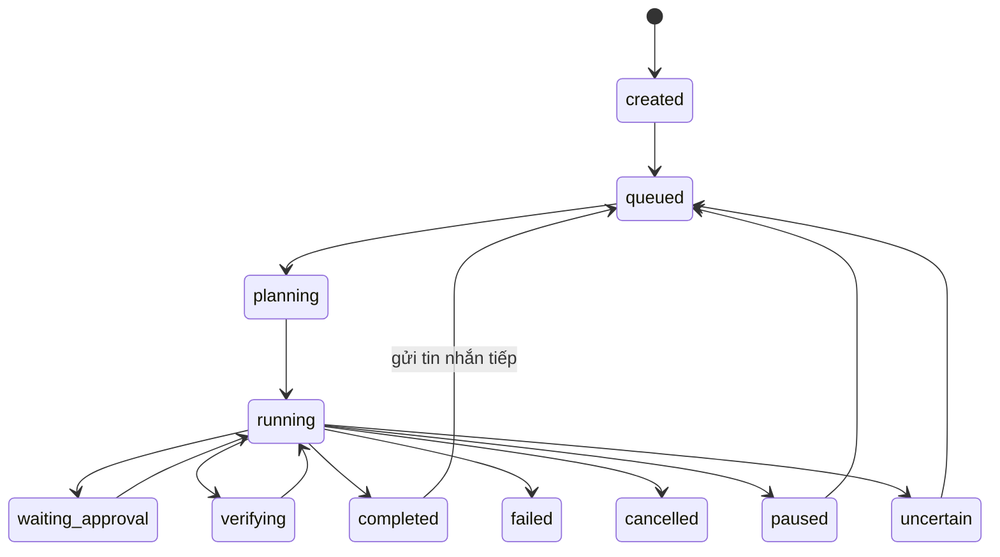

# Kiến trúc ChatMCP

Đây là kiến trúc **local-only một người dùng**, áp dụng cho nhánh refactor hiện tại. Tài liệu Phase 0–4 ghi lại quá trình phát triển, một số hướng dẫn cloud trong đó đã lỗi thời.

## 1. Sơ đồ

~~~mermaid
flowchart LR
  U[WinForms WebView2 or Browser UI] --> H[Hub localhost only]
  H --> A[AgentRunner and DualAgent]
  A --> P[Provider Gateway and Local Models]
  A --> G[PermissionGate and Checkpoints]
  G --> T[LocalTools GitRunner ShellRunner]
  H --> W[Parallel Coding Worktrees]
  H --> S[GitHub Agent Skills Hub]
  H --> D[Private User State]
  B[Optional Browser Companion] --> H
~~~

The Windows desktop starts the local Node Hub. It does not deploy a shared/public service.

## 2. Hai backend

Trong các phiên bản trước có hai backend local và MCP legacy. **Hiện chỉ còn local.** Toàn bộ đường Cloud Harness/Desktop Commander MCP proxy, Docker/Render hosting, public-mode login và remote workspace manager đã bị gỡ. Startup từ chối tùy chọn public, --repo-root và --backend mcp.

Outbound HTTPS đến nhà cung cấp AI, GitHub, Skills và nghiên cứu web **vẫn được hỗ trợ**. Local-only không có nghĩa offline-only.

## 3. Vòng lặp agent

AgentRunner gửi nội dung nhiệm vụ cho GatewayProvider, nhận lời gọi công cụ, chạy qua HubManager tool session, lưu bằng chứng và quay lại model đến khi kết thúc. Các provider hỗ trợ giao thức OpenAI-compatible, Anthropic và Gemini; Ollama/LM Studio ở localhost nếu model hỗ trợ tool-calling. Mô hình không được tự cấp thêm quyền chỉ bằng câu chữ trong prompt.

## 4. Đường đi của một lời gọi công cụ

1. Kiểm tra task, thế hệ workspace và JSON schema của tool.
2. PermissionGate phân loại lệnh và yêu cầu người dùng duyệt khi cần.
3. Ghi pending decision trước hành động có tác dụng.
4. Tạo checkpoint hoặc từ chối khi không thể bảo vệ dữ liệu.
5. Chạy LocalTools/StudioTools trong workspace với path và command guards.
6. Ghi kết quả thực tế, kể cả test pass/fail và tác vụ chưa rõ kết quả.

## 5. Máy trạng thái nhiệm vụ

Trạng thái tác vụ được xác thực bởi TRANSITIONS trong lib/task-state.mjs. Không tự replay tác vụ ghi không chắc chắn sau lỗi.

## 6. Phân quyền

PermissionGate trong lib/permissions.mjs là chính sách cục bộ và vẫn hoạt động. Các vai trò quản trị tenant/RBAC doanh nghiệp của public Hub đã bị loại bỏ. Có Review, Read-only, Autonomous và Full Access có xác nhận riêng.

## 7. Công cụ cục bộ

`local-tools.mjs` — 95 công cụ; StudioTools bổ sung kiểm tra, checkpoint, code intelligence và Git review. Các tool không thuộc danh sách cho phép không được thực thi.

## 8. Chạy lệnh và các lớp bảo vệ quanh nó

ShellRunner lọc biến môi trường, áp timeout, kiểm tra lệnh và đường dẫn. Tuy vậy lệnh được duyệt chạy với quyền tài khoản hệ điều hành hiện tại. SandboxEngine hiện chỉ là chế độ host (osIsolated:false) và **không phải** VM/AppContainer. Optional Docker sandbox chỉ dành cho bài test cục bộ, không phải cloud hosting.

## 9. Nhà cung cấp mô hình và khóa API

Khóa lưu dưới state directory per-user, được che khi ghi log. Endpoint của provider phải được cấu hình và origin thay đổi không được tự ý nhận khóa cũ. Dữ liệu gửi ra remote provider tuân theo lựa chọn của người dùng; Ollama/LM Studio có thể chạy hoàn toàn cục bộ.

## 10. Độ bền và phục hồi

Transcript, task history và evidence được lưu trên ổ đĩa per-user. Checkpoint restore kiểm tra SHA và xung đột. Worktree coding worker giữ thay đổi trên branch riêng, cần review commit/diff trước khi tích hợp.

## 11. Dữ liệu trên đĩa

Mặc định Windows: %LOCALAPPDATA%\ChatMCP\hub; có thể đổi bằng --state-dir. Đây là dữ liệu riêng tư gồm lịch sử, key store, logs, checkpoints, skills registry và coding-agent state. Không lưu vào repository.

## 12. HTTP API (nội bộ của dashboard)

Chỉ lắng nghe 127.0.0.1; kiểm tra Host và Origin, giới hạn CORS, CSRF cho mọi POST từ giao diện. Browser companion có một số đường pairing được kiểm soát riêng. Các API workspace hosted/tenant governance cũ trả 404 hoặc không tồn tại.

## 13. Giao diện

`ui/src/lib/api.ts` adapts `agent.tasks` summaries into the session list and loads the selected full task separately. `task-view.ts` maps recorded dialogue/prompts/runs/events into the conversation view and canonical states into controls. Permission reviews come from `studio.permissions`, never inferred task fields. Plans, Git and terminal sessions use existing Studio routes. `useTaskStream` subscribes to the real task event endpoint; it scopes transient text by task ID and refetches durable state on reconnect because SSE does not provide event replay. Polling remains a recovery fallback. This does not add provider-level token streaming.

React/TypeScript/Vite trong CHATMCP-HUB/ui được biên dịch vào CHATMCP-HUB/web/dist và nhúng trong desktop WinForms + WebView2. Các tab gồm Files, Git, Agents, Skills, Terminal, Plans, Preview và Settings. Luôn build lại UI trước khi đóng gói installer.

## 14. Ranh giới tin cậy

| Bên liên quan | Biện pháp | Giới hạn |
| --- | --- | --- |
| Desktop -> Hub | Loopback, Host, Origin, CSRF, CSP | Máy đang dùng vẫn phải tin cậy |
| Model -> tools | PermissionGate, checkpoint, đường dẫn | Shell host vẫn nguy hiểm |
| Coding workers | Git worktree riêng, limited tools, review diff | Không phải OS sandbox |
| GitHub Skills | Pin SHA, hash blob, giới hạn size, opt-in | Third-party content không đáng tin |
| AI provider | API key được bảo vệ theo origin | Remote model nhận dữ liệu nếu được chọn |

## 15. Chiến lược phụ thuộc

Node.js >=22.12 khi chạy từ source, Git for Windows để sử dụng Git/worktree, WebView2 Runtime cho desktop. Installer mang theo Node portable; .NET SDK 10 chỉ dùng lúc build. Optional ConPTY, Playwright, Python test runner và Docker test sandbox tách biệt khỏi runtime server.

Các nguồn Cloud Harness proxy và Render/Docker public-hosting không còn là phụ thuộc sản phẩm.

## 16. Độ lệch so với thiết kế và hạng mục chưa làm

Không hỗ trợ public SaaS, public multi-tenant hoặc Cloud Harness backend. MCP client tích hợp một cách chính thức cho local server khác, sandbox Windows cấp hệ điều hành, benchmark model thật, cập nhật tự động và clean-VM installer E2E là các hướng tương lai. Các tài liệu thiết kế Phase 1–4 là lịch sử, không phải mô tả hiện tại.

## 17. Parallel Coding Workers và Skills Registry nâng cao (nhánh phát triển)

CodingWorktreeOrchestrator chạy tối đa bốn worker trên Git worktrees riêng, giới hạn tool sửa file. Người dùng xem diff và xác nhận trước khi merge vào nhánh integration mới; Draft PR cũng cần xác nhận, không tự merge main. Worktree chỉ cách ly working copy và Git index.

Skills Hub duyệt SKILL.md lồng sâu theo Git tree được pin, kiểm tra blob SHA của tài nguyên text/binary, quản lý nguồn/update và ghi thông tin license evidence. Mặc định skills bên thứ ba tắt; không tự chạy script.

## 16. Multi-Agent Orchestrator và GitHub Skills Hub (giai đoạn đầu)

StudioDelegates là read-only DAG phục vụ research/planning/review, không có tools thực thi. Chức năng này độc lập với các coding workers có worktree riêng.

Tham khảo [Development](DEVELOPMENT.md), [Windows Setup](WINDOWS-SETUP.md), [User Guide](USER-GUIDE.md) và [Security](../SECURITY.md).
