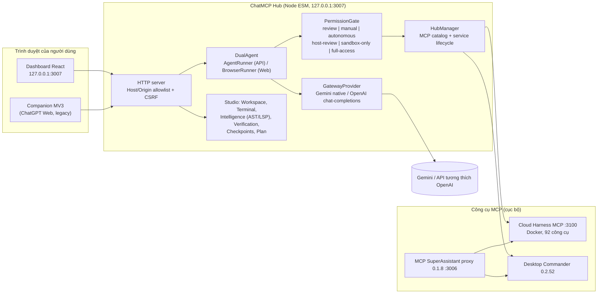

# Kiến trúc ChatMCP

Tài liệu mô tả kiến trúc **như đang có trong mã** (Hub 2.2.8, kiểm tra ngày 2026-10-10) và hướng đi của các phase tiếp theo. Phần nào là kế hoạch được ghi rõ là *kế hoạch*.

## 1. Sơ đồ hiện tại

Hub là một tiến trình Node duy nhất, không có bước build; giao diện là React nhúng offline (`CHATMCP-HUB/web/vendor`, hiện là React 16.0.x) và các tệp tĩnh.

## 2. Vòng lặp agent

`AgentRunner` (`lib/agent.mjs`) điều khiển một nhiệm vụ bằng mô hình qua `GatewayProvider`. Mô hình chỉ thấy **bốn công cụ định tuyến**: `mcp_catalog`, `mcp_describe`, `mcp_call`, `mcp_capabilities`; công cụ thật nằm sau `mcp_call` và được phân loại, cấp quyền rồi mới thực thi. Lịch sử dùng định dạng nội bộ giống OpenAI Responses.

Độ bền: mỗi nhiệm vụ có `transcript.jsonl` bền vững. Trước khi gọi công cụ có tác dụng phụ, runner ghi `pendingCall`; nếu Hub chết giữa chừng, khi khởi động lại nó **không phát lại** lời gọi chưa rõ kết quả mà đánh dấu *không chắc chắn* để người dùng quyết định. Lỗi mạng tới mô hình được thử lại *trước* khi thực thi công cụ mới; riêng gateway Gemini có các đường sửa lỗi định dạng và nén ngữ cảnh khi gặp HTTP 413.

Trạng thái nhiệm vụ hiện là các chuỗi rời rạc nằm rải rác trong mã (ví dụ `queued`, `preparing`, `running`, `paused`, `completed`, `failed`), chưa có một máy trạng thái tường minh; máy trạng thái theo đặc tả (`created → queued → planning → running → waiting_approval → verifying → paused → completed/failed/cancelled/uncertain`) là hạng mục Phase 1.

## 3. Phân quyền

`PermissionGate.classify` phân loại **theo tên công cụ** thành `read`, `checkpoint`, `workspace_edit`, `execute`, `dangerous`, `unknown`:

- `read`, `checkpoint`: luôn cho phép (trừ chính sách `sandbox-only` chặn mọi công cụ MCP ngoài `studio.*`).
- `workspace_edit`: tự cho phép ở chế độ `autonomous`, còn lại cần phê duyệt (hết hạn sau 10 phút → từ chối).
- `execute`, `dangerous`, `unknown`: **luôn cần phê duyệt**, kể cả `autonomous`.
- `full-access`: chỉ bật khi gõ chính xác `FULL ACCESS`; bỏ qua mọi kiểm tra workspace và phê duyệt, chạy với quyền của tài khoản Windows hiện tại.
- Đối số có khóa kiểu `path|file|directory|source|target|…` được kiểm tra nằm trong workspace trước khi xin phê duyệt.

Khoảng trống đã ghi nhận (xem audit): chưa có chế độ *Read Only* thuần; nội dung lệnh shell không được phân tích (chỉ tên công cụ); hằng `SENSITIVE` khai báo nhưng chưa dùng.

## 4. Workspace và công cụ cục bộ

- `StudioWorkspace`: cây thư mục, đọc/tìm kiếm, checkpoint → review → accept/restore, git status/diff. Mọi đường dẫn đi qua `realpath` và phải nằm trong workspace; `.env` bị từ chặn đọc; liên kết trỏ ra ngoài bị từ chối (đã kiểm thử).
- `StudioTerminal`: lệnh một lần hoặc phiên tương tác; PowerShell trên Windows, `$SHELL` nơi khác. ConPTY chỉ khi `node-pty` thật sự chạy được (được thăm dò một lần), nếu không dùng pipe và nói rõ lý do. `stop()` kết thúc cả cây tiến trình (`taskkill /T` trên Windows, process-group trên POSIX); `close()` đợi tiến trình thoát.
- `StudioSandbox`: chạy lệnh kiểm thử trong container Docker chỉ-đọc, không mạng, bỏ mọi capability. Không hỗ trợ terminal tương tác.
- `CodeIntelligence`: chỉ mục ký hiệu — AST cho Python (worker `workers/python_index.py`, trên Windows gọi `py -3.11`) và nhận dạng ký hiệu cho JS/TS; LSP (Pyright, typescript-language-server) tùy chọn nếu đã cài.
- Công cụ `studio.*` mà agent gọi hiện **chỉ đọc + kế hoạch**; thao tác ghi/chạy lệnh của agent đi qua MCP (Desktop Commander/Cloud Harness). Đây là lý do Hub chưa chạy được hoàn toàn cục bộ — Phase 1 thêm backend cục bộ.

## 5. Ranh giới tin cậy

| Ranh giới | Cơ chế hiện có | Giới hạn |
|---|---|---|
| Dashboard ↔ Hub | bind 127.0.0.1, allowlist Host/Origin, header + token CSRF | không có tài khoản; không an toàn nếu mở ra mạng |
| Tiện ích ↔ Hub | mã ghép cặp, kiểm tra Origin `chrome-extension://…` | chỉ cho chế độ ChatGPT Web |
| Hub ↔ mô hình | HTTPS; khóa API DPAPI tùy chọn | khóa nằm trong bộ nhớ Hub khi chạy |
| Hub ↔ MCP | loopback + bearer (Cloud Harness) | bearer = quyền điều khiển toàn bộ công cụ, gồm Docker socket |
| Agent ↔ file | PermissionGate + realpath + chặn `.env` | lệnh shell host chạy với quyền người dùng |
| Người dùng A ↔ B | **không có** | không hỗ trợ đa người dùng |

## 6. Chiến lược phụ thuộc

- **Cloud Harness MCP**: phụ thuộc bên thứ ba (MIT), **không fork, không sửa, không phân phối lại**. Ghim tại `deps/cloud-harness.lock.json` (tag `v0.62.8` = commit `ad1fffc9993e…`); `scripts/bootstrap-cloud-harness.{ps1,sh}` tải hoặc *xác minh* bản checkout (commit, không sửa đổi, hash giấy phép) và không bao giờ xóa gì. Nâng cấp = đổi file khóa + chạy lại kiểm thử tích hợp. Sẽ trở thành backend **tùy chọn**; Hub không được yêu cầu nó để chạy cục bộ.
- **Gói npm lúc chạy** (`@wonderwhy-er/desktop-commander@0.2.52`, `@srbhptl39/mcp-superassistant-proxy@0.1.8`) được Hub cài với phiên bản cố định; phụ thuộc bắc cầu chưa được ghim bằng lockfile (rủi ro đã ghi nhận).
- **Gói đóng gói trong repo**: React/ReactDOM nhúng ở `web/vendor` (16.0.x, cũ — nâng cấp là hạng mục UI); `node-pty` + `nan` là phụ thuộc tùy chọn, **không còn được commit** (`node_modules` đã bị gỡ khỏi Git).
- Giấy phép: xem [THIRD-PARTY-NOTICES.md](../THIRD-PARTY-NOTICES.md).

## 7. Hướng đi (kế hoạch, chưa hoàn thành)

1. **Backend thực thi cục bộ** (Phase 1): công cụ fs/edit/shell/git trong tiến trình Hub, đi qua `PermissionGate`, thư mục trạng thái độc lập với Cloud Harness, không cần Docker.
2. **Lớp adapter nhà cung cấp**: giao diện `listModels / validateConfiguration / streamResponse / executeToolCall / estimateUsage / normalizeError` cho OpenAI, Anthropic, Gemini, API tương thích OpenAI; chế độ API là mặc định, ChatGPT Web ẩn sau cờ thử nghiệm.
3. **Máy trạng thái nhiệm vụ**, phát sự kiện SSE, quản lý ngữ cảnh/nén.
4. **Tự host đáng tin cậy** (Phase 2): Docker Compose, xác thực, HTTPS, health, backup, CI/CD.
5. Đa người dùng chỉ sau khi có bằng chứng cô lập cấp VM/microVM (Phase 3/4); Cloud Harness một mình **không** đủ.
