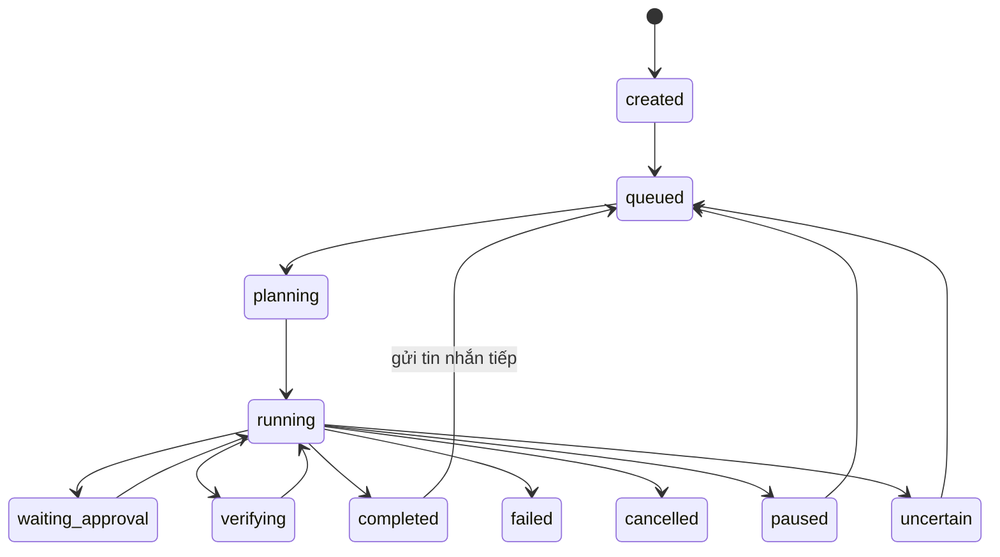

# Kiến trúc DatGold

Đây là kiến trúc **local-only một người dùng**, áp dụng cho nhánh refactor hiện tại. Tài liệu Phase 0–4 ghi lại quá trình phát triển, một số hướng dẫn cloud trong đó đã lỗi thời.

## 1. Sơ đồ

~~~mermaid
flowchart LR
  U[WinForms WebView2 or Browser UI] --> H[Hub localhost only]
  H --> A[AgentRunner and DualAgent]
  A --> P[Provider Gateway and Local Models]
  A --> G[PermissionGate and Checkpoints]
  G --> T[LocalTools GitRunner ShellRunner]
  H --> W[Parallel Coding Worktrees]
  H --> S[GitHub Agent Skills Hub]
  H --> D[Private User State]
  B[Optional Browser Companion] --> H
~~~

The Windows desktop starts the local Node Hub. It does not deploy a shared/public service.

## 2. Hai backend

Trong các phiên bản trước có hai backend local và MCP legacy. **Hiện chỉ còn local.** Toàn bộ đường Cloud Harness/Desktop Commander MCP proxy, Docker/Render hosting, public-mode login và remote workspace manager đã bị gỡ. Startup từ chối tùy chọn public, --repo-root và --backend mcp.

Outbound HTTPS đến nhà cung cấp AI, GitHub, Skills và nghiên cứu web **vẫn được hỗ trợ**; thêm một yêu cầu tới `https://models.dev/api.json` để cập nhật danh mục model, chỉ khi chủ máy bấm nút cập nhật (mục 9). Local-only không có nghĩa offline-only.

## 3. Vòng lặp agent

AgentRunner gửi nội dung nhiệm vụ cho GatewayProvider, nhận lời gọi công cụ, chạy qua HubManager tool session, lưu bằng chứng và quay lại model đến khi kết thúc. Các provider hỗ trợ giao thức OpenAI-compatible, Anthropic và Gemini; Ollama/LM Studio ở localhost nếu model hỗ trợ tool-calling. Mô hình không được tự cấp thêm quyền chỉ bằng câu chữ trong prompt.

## 4. Đường đi của một lời gọi công cụ

1. Kiểm tra task, thế hệ workspace và JSON schema của tool.
2. PermissionGate phân loại lệnh và yêu cầu người dùng duyệt khi cần.
3. Ghi pending decision trước hành động có tác dụng.
4. Tạo checkpoint hoặc từ chối khi không thể bảo vệ dữ liệu.
5. Chạy LocalTools/StudioTools trong workspace với path và command guards.
6. Ghi kết quả thực tế, kể cả test pass/fail và tác vụ chưa rõ kết quả.

## 5. Máy trạng thái nhiệm vụ

Trạng thái tác vụ được xác thực bởi TRANSITIONS trong lib/task-state.mjs. Không tự replay tác vụ ghi không chắc chắn sau lỗi.

## 6. Phân quyền

PermissionGate trong lib/permissions.mjs là chính sách cục bộ và vẫn hoạt động. Các vai trò quản trị tenant/RBAC doanh nghiệp của public Hub đã bị loại bỏ. Có Review, Read-only, Autonomous và Full Access có xác nhận riêng.

## 7. Công cụ cục bộ

`local-tools.mjs` — 99 công cụ; StudioTools bổ sung kiểm tra, checkpoint, code intelligence và Git review. Các tool không thuộc danh sách cho phép không được thực thi.

**Tìm kiếm.** `search_files` và `find_files` dùng ripgrep khi có: bản bộ cài đặt đi kèm trong `runtimes/ripgrep`, hoặc, khi chạy từ mã nguồn (bản đã cài không bao giờ lấy `rg` từ PATH), `rg` trên PATH (`CHATMCP_RIPGREP=<đường dẫn tuyệt đối>` để chọn nhị phân, `CHATMCP_RIPGREP=off` để tắt). Ripgrep biết `.gitignore` và nhanh hơn nhiều trên cây lớn; nó chạy như một tiến trình phụ chỉ đọc với dòng lệnh cố định (mẫu truyền qua `-e`, không shell, không file cấu hình, môi trường đã lọc), dưới mọi chính sách thực thi, giống `git`. Hub vẫn tự quyết file nào được hiện (bí mật, `.git`, thư mục nhiễu, glob chính xác) cả khi hỏi lẫn khi nhận câu trả lời. Thiếu ripgrep hoặc ripgrep lỗi thì Hub tự tìm: trong kho Git lấy danh sách file từ Git (tôn trọng `.gitignore`, không đi qua liên kết), ngoài kho thì duyệt cây như trước; `include_ignored: true` luôn duyệt cả file bị `.gitignore` loại. Lookahead và backreference chỉ chạy được khi ripgrep có PCRE2 (và backreference không bao giờ chạy trong tiến trình của Hub). Một khác biệt có chủ đích giữa hai cách tìm: `\w`, `\d`, `\b` trong ripgrep hiểu Unicode (`Việt` gồm toàn ký tự chữ), còn bản tìm của Hub theo JavaScript chỉ hiểu ASCII. Kết quả có thể thiếu khi một file không đọc được hoặc PCRE2 bỏ cuộc ở một dòng quá phức tạp; câu trả lời nói rõ điều đó (`incomplete`). Tìm bằng ripgrep không chắc cùng tập kết quả với bản tìm của Hub khi đụng giới hạn số kết quả (ripgrep duyệt song song), nhưng thứ tự hiển thị luôn là thứ tự duyệt cây.

## 8. Chạy lệnh và các lớp bảo vệ quanh nó

ShellRunner lọc biến môi trường, áp timeout, kiểm tra lệnh và đường dẫn. Tuy vậy lệnh được duyệt chạy với quyền tài khoản hệ điều hành hiện tại. SandboxEngine hiện chỉ là chế độ host (osIsolated:false) và **không phải** VM/AppContainer. Optional Docker sandbox chỉ dành cho bài test cục bộ, không phải cloud hosting.

## 9. Nhà cung cấp mô hình và khóa API

Khóa lưu dưới state directory per-user, được che khi ghi log. Endpoint của provider phải được cấu hình và origin thay đổi không được tự ý nhận khóa cũ. Dữ liệu gửi ra remote provider tuân theo lựa chọn của người dùng; Ollama/LM Studio có thể chạy hoàn toàn cục bộ.

**Danh mục model và mức suy luận.** `lib/model-catalog.mjs` trả lời "model này có giới hạn, giá và cách điều khiển suy luận thế nào" từ một bản chụp có ngày của https://models.dev/api.json (`lib/model-catalog.data.json`, giấy phép MIT, định dạng 2 có bậc giá theo cỡ lời nhắc và trạng thái model, dựng bằng `scripts/update-model-catalog.mjs` từ `lib/model-catalog-build.mjs`; Hub không tải gì, trừ khi chủ máy bấm **Cập nhật từ models.dev**: xem đoạn dưới). Mỗi câu trả lời ghi nguồn (`catalog@NGÀY`) và độ chắc chắn (`exact`, `normalized`, `alias`, `none`): một id không có trong danh mục (bí danh của người dùng, thẻ Ollama) trả về `none`, không bao giờ đoán sang model khác. `lib/reasoning-effort.mjs` đặt cài đặt "mức suy luận" (`auto` hoặc một mức) lên từng giao thức: `reasoning_effort` (Chat Completions), `reasoning: {effort}` (OpenRouter và Responses), `output_config: {effort}` (Anthropic Messages; với mức cao thì `max_tokens` được nâng lên mặc định để còn chỗ viết câu trả lời), `generationConfig.thinkingConfig` (Gemini: `thinkingLevel` cho Gemini 3 và 4; `thinkingBudget` cho Gemini 2.5, nơi các mức được quy ra ngân sách token 512 / 1.024 / 8.192 / 24.576 và "max" là ngân sách lớn nhất của model, không gửi cả hai vì API trả 400; `maxOutputTokens` được nâng lên để còn chỗ viết câu trả lời sau phần suy nghĩ). Nhà cung cấp từ chối thiết lập (400 nêu tên trường) thì adapter gửi lại đúng yêu cầu model đó một lần không kèm nó, và `GatewayProvider` nhớ theo endpoint + model + mức. `GET /api/ai/model-info` đưa cùng câu trả lời cho trang cài đặt. Mức nằm trong `gateway-config.json` và trong từng hồ sơ model. Một tác vụ có thể mang mức riêng (`task.reasoningEffort`, chọn khi bắt đầu hoặc ở một lượt tiếp theo; `taskReasoningEffort` từ chối từ không phải mức trước khi có tác vụ): `AgentRunner` chuyển nó cho `GatewayProvider.respond`, nó thắng mức của kết nối trong lượt đó (`auto` là không gửi gì), agent con thừa hưởng, và kênh ChatGPT Web Companion từ chối nó vì đây là thiết lập của Model API.

**Danh mục cấp ngân sách, chi phí và cập nhật.** `lib/model-facts.mjs` biến câu trả lời *chắc chắn* của danh mục (`exact` hoặc `normalized`, không bao giờ `alias`) thành các dữ kiện mà bộ lập kế hoạch dùng: cửa sổ, giới hạn đầu vào (`maxInput`), giới hạn đầu ra (`outputCap`, chỉ khi từ 1.024 trở lên), giá kể cả các bậc, và hai **năng lực**: `modelCapacity` (cái model cho phép: cửa sổ, hoặc, khi model nhận vào ít hơn cửa sổ, số lớn nhất mà lời nhắc được lập kế hoạch vẫn không dài hơn `maxInput`: tối đa `maxInput` cộng phần đầu ra dành cho agent, tính bằng đúng hai công thức dự phòng của ngân sách một lượt chạy trong `lib/context-reserve.mjs`) và `capacity` (cái Hub lập kế hoạch khi chủ máy không nhập cửa sổ: `modelCapacity`, nhưng không quá mốc đầu tiên mà giá của đúng dòng nhà cung cấp + model đó tăng theo độ dài lời nhắc, `firstPriceRise`, và không dưới sàn 128.000, `PRICE_CAP_FLOOR_TOKENS`; `priceCap` nói mốc nào đã chặn và có phải sàn nâng nó lên không, null khi không có gì chặn). Mốc giá chỉ có thể hạ `capacity`, không bao giờ nâng nó quá `modelCapacity`, và số chủ máy nhập vẫn thắng. `GatewayProvider` dùng chúng: `state().contextWindowTokens` vẫn là số chủ máy nhập, `effectiveContextWindowTokens` là số Hub thật sự lập kế hoạch (chủ máy, rồi danh mục, rồi không có) và `contextWindowSource` là `configured`, `catalog` hoặc `fallback`; `resolveEffectiveContextBudget` ghi nguồn (`provider_configuration`, `trusted_model_metadata` hoặc `conservative_fallback`), việc chọn công cụ (`followProviderWindow`) và việc cắt lịch sử của adapter theo đúng cửa sổ đó; không preset nào còn mang cửa sổ cố định (danh mục trả lời cho từng model; 128.000 của DeepSeek đã bỏ cùng `deepseek-chat`, mặc định nay là `deepseek-flash`). Giá được đóng băng vào `context.pricing` khi một lượt chạy bắt đầu, và `lib/model-cost.mjs` tính chi phí: giá chủ máy nhập luôn thắng; không có thì, với model danh mục chắc chắn, ước tính từ giá danh mục (bậc cao nhất có `aboveTokens` nhỏ hơn số token của lời nhắc, áp cho cả yêu cầu), đánh dấu `approximate` và `estimateSource` trong sổ chi phí (lược đồ vẫn là 1, chỉ thêm trường) và giao diện ghi **(ước tính)**; thiếu tách cache thì mọi token vào tính theo giá vào, thiếu giá cache thì dùng giá vào, giá suy luận và âm thanh của danh mục chưa dùng. Token suy luận của Gemini (`thoughtsTokenCount`) được cộng vào đầu ra. `lib/model-catalog-store.mjs` giữ bản danh mục chủ máy đã cập nhật (`<thư mục dữ liệu>/model-catalog.json`): đúng một yêu cầu tới `https://models.dev/api.json` và chỉ khi `POST /api/ai/catalog/refresh` được gọi (không key, không cookie, không nội dung, không theo chuyển hướng, 30 giây, 12 MB); kết quả được kiểm (`validateRaw`, `checkSnapshot`) trước khi thay bản đang dùng và được ghi nguyên tử; hai lần cập nhật cùng lúc dùng chung một yêu cầu; tệp trong thư mục dữ liệu cũng không được tin (hỏng, cũ hơn bản đi kèm hoặc đề ngày tương lai thì bị bỏ qua và `GET /api/ai/catalog` nói lý do). Các route khác: `GET /api/ai/catalog` (nguồn, tuổi, số model) và `GET /api/ai/catalog/models` (danh sách model của một nhà cung cấp cho bộ chọn; chỉ đọc bản danh mục đang dùng, tối đa 1.000 model).

**Văn bản hiện dần (streaming).** Khi người xem có chỗ hiện chữ (`AgentRunner` luôn có), `GatewayProvider` đòi nhà cung cấp trả lời dạng luồng và đẩy từng mảnh văn bản ra giao diện thành sự kiện `token`. Mọi giao thức đi qua một bộ đọc SSE duy nhất, `lib/sse.mjs` (dòng kết thúc LF, CRLF hoặc CR; nhiều dòng `data`; dòng bình luận là tín hiệu còn sống; BOM; trần dung lượng; huỷ giữa chừng đóng kết nối; một handler trả `SSE_STOP` để kết thúc đọc khi giao thức biết luồng đã hết, vì máy chủ có thể không đóng kết nối). Mỗi giao thức có một **bộ gom** dựng lại từ các sự kiện đúng cái câu trả lời mà API trả khi không stream, rồi đưa qua cùng bộ chuẩn hoá của đường không stream: `lib/openai-chat-stream.mjs` cho Chat Completions (mảnh `tool_calls` theo `index`, `reasoning_content`, `refusal`, chunk `usage`), nên câu trả lời stream và không stream không thể khác nhau; kiểm tra bằng mười hai luồng mẫu theo hình dạng của OpenAI, OpenRouter, DeepSeek, Ollama, LM Studio, vLLM và Azure (`tests/fixtures/streams/`, viết từ một kế hoạch cùng với câu trả lời không stream của nó, **không** ghi lại từ tài khoản thật). `lib/anthropic-stream.mjs` làm việc đó cho Messages API: khối `text`, khối `tool_use` (JSON của lời gọi chỉ được đọc một lần, khi khối đóng), khối `thinking` với `signature_delta`; `message_delta` mang usage **cộng dồn** nên thay giá trị chứ không cộng; `message_stop` là sự kiện kết thúc và sau nó không đọc thêm; `ping` bỏ qua, sự kiện lạ bỏ qua, sự kiện `error` (ví dụ `overloaded_error`) là lỗi HTTP tương ứng (529, thử lại được); mười ba luồng mẫu theo tài liệu streaming và theo các gateway phục vụ API này. `lib/gemini-stream.mjs` làm việc đó cho Gemini: yêu cầu đi tới đường song sinh `models/<model>:streamGenerateContent?alt=sse` của đường `:generateContent` (một đường dẫn tự đặt không có song sinh nên giữ đường thường), mỗi sự kiện là một `GenerateContentResponse` đầy đủ; các đoạn chữ liền nhau gộp thành một part, part mang `thoughtSignature` thì đóng lại để chữ ký ở nguyên trên đoạn chữ của nó; `finishReason` (hoặc prompt bị chặn mà không có candidate) là sự kiện kết thúc nên một lời gọi hàm chỉ thuộc câu trả lời sau đó; chỉ kiểu yêu cầu `native` stream, ba kiểu tương thích của gateway còn lại (`gemini-compat.mjs`) giữ đường thường, và yêu cầu bị gateway từ chối vì thiết lập thinking hay vì khoảng token đầu ra vẫn được hỏi lại khi đang stream; mười một luồng mẫu. Trần token đầu ra của Gemini không còn là 8.192 cố định: lấy từ danh mục model (`facts.outputCap` khi người gọi không nói gì, không bao giờ quá `facts.maxOutput` của model và 65.536), còn model hay gateway mà danh mục không chắc thì giữ 8.192 như trước. Quy tắc **đóng khi lỗi** (`lib/model-stream.mjs`): lời gọi công cụ chỉ thuộc câu trả lời khi luồng được xác nhận là đã xong (Chat: có `finish_reason`; câu trả lời chỉ có chữ thì `[DONE]` cũng đủ; Messages: `message_stop` sau một `message_delta` có `stop_reason`, mọi khối đã đóng) và đối số của nó đọc được thành một đối tượng JSON. Luồng **bị cắt** (kết nối đóng êm mà không có sự kiện kết thúc), **hỏng** (sự kiện không phải JSON, mảnh sai chỗ, đối số không đọc được, hoàn tất mà trống rỗng) không bao giờ được dùng: cùng yêu cầu được gửi lại đúng một lần với `stream: false` (chưa công cụ nào chạy nên không gì bị lặp; yêu cầu thứ hai được đếm và công bố như mọi lần thử lại), phần chữ đã hiện bị thu lại (sự kiện `token_reset`), và `GatewayProvider` nhớ endpoint + model đó không stream được để các lần sau không hỏi lại (một lệnh gọi cho model khác hoặc endpoint khác hỏi lại). Lỗi nằm **trong** luồng (đối tượng `error`) được xử lý đúng như lỗi HTTP cùng loại (429 và 5xx thử lại, 401 dừng, quota dừng), nên một `server_error` giữa chừng được gọi lại như luồng. Mất kết nối giữa luồng được thử lại như luồng. Một luồng có hai đồng hồ riêng: **im lặng** 120 giây (mỗi byte, kể cả dòng bình luận giữ kết nối, đặt lại đồng hồ) và **tổng** 30 phút; thời hạn 4 phút của yêu cầu thường chỉ còn là thời gian chờ phản hồi bắt đầu, vì một model viết lâu không phải là lỗi, còn một luồng im lặng hay không bao giờ kết thúc thì là lỗi. Trần dung lượng của luồng là 64 MiB (sự kiện lớn gấp nhiều lần câu trả lời), không phải 12 MiB của một phản hồi thường. Với Chat Completions, yêu cầu mang `stream_options.include_usage`; máy chủ trả 400 vì không biết nó bị hỏi lại một lần không có nó (và được nhớ theo endpoint). Máy chủ không biết `stream` mà trả JSON thì được đọc như JSON và chữ hiện một lần ở cuối; máy chủ trả 400 vì `stream` bị hỏi lại một lần với `stream: false`. Giới hạn: chữ hiện dần chưa qua bước che bí mật của bản ghi cuối (mảnh chữ không che đáng tin cậy được vì một bí mật có thể bị cắt giữa hai mảnh); chỉ bản lưu vào bản ghi được che.

## 10. Độ bền và phục hồi

Transcript, task history và evidence được lưu trên ổ đĩa per-user. Checkpoint restore kiểm tra SHA và xung đột. Worktree coding worker giữ thay đổi trên branch riêng, cần review commit/diff trước khi tích hợp.

## 11. Dữ liệu trên đĩa

Mặc định Windows: %LOCALAPPDATA%\ChatMCP\hub; có thể đổi bằng --state-dir. Đây là dữ liệu riêng tư gồm lịch sử, key store, logs, checkpoints, skills registry, coding-agent state và, chỉ khi chủ máy đã bấm cập nhật, `model-catalog.json` (danh mục model đã tải; mục 9). Không lưu vào repository.

## 12. HTTP API (nội bộ của dashboard)

Chỉ lắng nghe 127.0.0.1; kiểm tra Host và Origin, giới hạn CORS, CSRF cho mọi POST từ giao diện. Browser companion có một số đường pairing được kiểm soát riêng. Các API workspace hosted/tenant governance cũ trả 404 hoặc không tồn tại.

## 13. Giao diện

`ui/src/lib/api.ts` adapts `agent.tasks` summaries into the session list and loads the selected full task separately. `task-view.ts` maps recorded dialogue/prompts/runs/events into the conversation view and canonical states into controls. Permission reviews come from `studio.permissions`, never inferred task fields. Plans, Git and terminal sessions use existing Studio routes. `useTaskStream` subscribes to the real task event endpoint; it scopes transient text by task ID and refetches durable state on reconnect because SSE does not provide event replay. Polling remains a recovery fallback. The text a model streams arrives as `token` events (and `token_reset` when a stream that was cut is replaced by another request: see section 9); the page shows it until the persisted answer replaces it.

React/TypeScript/Vite trong CHATMCP-HUB/ui được biên dịch vào CHATMCP-HUB/web/dist và nhúng trong desktop WinForms + WebView2. Các tab gồm Files, Git, Agents, Skills, Terminal, Plans, Preview và Settings. Luôn build lại UI trước khi đóng gói installer.

## 14. Ranh giới tin cậy

| Bên liên quan | Biện pháp | Giới hạn |
| --- | --- | --- |
| Desktop -> Hub | Loopback, Host, Origin, CSRF, CSP | Máy đang dùng vẫn phải tin cậy |
| Model -> tools | PermissionGate, checkpoint, đường dẫn | Shell host vẫn nguy hiểm |
| Coding workers | Git worktree riêng, limited tools, review diff | Không phải OS sandbox |
| GitHub Skills | Pin SHA, hash blob, giới hạn size, opt-in | Third-party content không đáng tin |
| AI provider | API key được bảo vệ theo origin | Remote model nhận dữ liệu nếu được chọn |

## 15. Chiến lược phụ thuộc

Node.js >=22.12 khi chạy từ source, Git for Windows để sử dụng Git/worktree, WebView2 Runtime cho desktop. Installer mang theo Node portable; .NET SDK 10 chỉ dùng lúc build. Optional ConPTY, Playwright, Python test runner và Docker test sandbox tách biệt khỏi runtime server.

Các nguồn Cloud Harness proxy và Render/Docker public-hosting không còn là phụ thuộc sản phẩm.

## 16. Độ lệch so với thiết kế và hạng mục chưa làm

Không hỗ trợ public SaaS, public multi-tenant hoặc Cloud Harness backend. MCP client tích hợp một cách chính thức cho local server khác, Windows Sandbox cấp hệ điều hành, benchmark model thật, cập nhật tự động và clean-VM installer E2E là các hướng tương lai. Các tài liệu thiết kế Phase 1–4 là lịch sử, không phải mô tả hiện tại.

## 17. Parallel Coding Workers và Skills Registry nâng cao (nhánh phát triển)

CodingWorktreeOrchestrator chạy tối đa bốn worker trên Git worktrees riêng, giới hạn tool sửa file. Người dùng xem diff và xác nhận trước khi merge vào nhánh integration mới; Draft PR cũng cần xác nhận, không tự merge main. Worktree chỉ cách ly working copy và Git index.

Skills Hub duyệt SKILL.md lồng sâu theo Git tree được pin, kiểm tra blob SHA của tài nguyên text/binary, quản lý nguồn/update và ghi thông tin license evidence. Mặc định skills bên thứ ba tắt; không tự chạy script.

## 16. Multi-Agent Orchestrator và GitHub Skills Hub (giai đoạn đầu)

StudioDelegates là read-only DAG phục vụ research/planning/review, không có tools thực thi. Chức năng này độc lập với các coding workers có worktree riêng.

Tham khảo [Development](DEVELOPMENT.md), [Windows Setup](WINDOWS-SETUP.md), [User Guide](USER-GUIDE.md) và [Security](../SECURITY.md).
